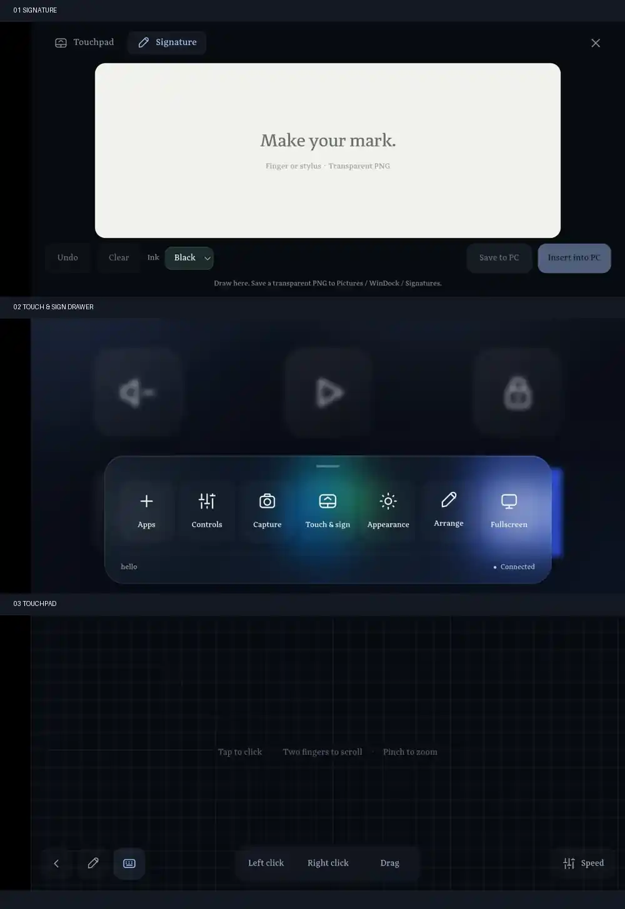

# Existing WinDock UI — screenshots and exact integration reference

These are the **user-provided screenshots of the existing WinDock Android-connected UI on 23 October 2026**, compiled into a single reduced-resolution WebP contact sheet. This is **NOT a mockup** or a Gamepad implementation. When designing new controls, preserve the app's current established layout and appearance.

[Open the image by itself](assets/current-ui-screenshots.webp)

## Screens, top to bottom in the composite

1. **Existing Signature screen** — Dark almost-black fullscreen shell; **Touchpad | Signature** navigation tabs on top (Signature selected with pale-blue accent). Close X at right. Large rounded off-white drawing canvas with “Make your mark.” / “Finger or stylus · Transparent PNG”. Bottom toolbar Undo, Clear, Ink color selector, Save to PC, Insert into PC; muted connection/status text.
2. **Existing dashboard drawer** — Frosted dark-glass round rectangular dock at bottom with a color glow behind. Seven actions: Apps, Controls, Capture, **Touch & sign**, Appearance, Arrange, Fullscreen. PC name and connection indicator underneath. **Keep the Touch & sign dashboard action**; do not add a top-level Gamepad action unless user explicitly changes this.
3. **Existing Touchpad screen** — Very dark fullscreen surface with fine square grid and central “Tap to click · Two fingers to scroll · Pinch to zoom”. Bottom-left row: Back, Signature shortcut, Keyboard shortcut; bottom-center mouse controls: Left click, Right click, Drag; bottom-right Speed control. Touchpad's fullscreen minimal treatment differs from Signature's top tabs.

## Exact behavior to build **later**, not yet implemented

- **Gamepad joins this same Touch & sign section** as the third mode: Touchpad | Signature | Gamepad.
- Add a Gamepad shortcut to the Touchpad's bottom-left navigation. Make Gamepad → Touchpad one tap, no dashboard travel.
- Keep Signature top tabs and expand them to include Gamepad.
- Native Kotlin gamepad UI may be a fullscreen Activity/View; on exit it must return to the existing Touch & sign input surface (normally Touchpad), not the home dashboard. Preserve trusted endpoint, pairing and session.
- Gamepad controls remain selectable 0/1/2 analog sticks, D-pad, ABXY, LB/RB, LT/RT, Menu/View. Full profile/custom editor; **no haptics**; gyro only in a future opt-in phase, not v1.
- Match existing palette: navy/charcoal near-black base, faint grid, soft blue accents, subtle translucent glass, low visual clutter.
- UI screenshot reference is authoritative for **the 2026-10-23 captured appearance only**, and is not a guarantee that upstream current HEAD hasn't changed. Compare with code before implementing.

## Corresponding source files (fork)

- [`public/index.html`](../../public/index.html): drawer, `#input-pad` modal, Touchpad/Signature tabs, toolbar and panes.
- [`public/input-pad.js`](../../public/input-pad.js): mode switching, WebSocket touchpad lifecycle and release behavior.
- [`public/style.css`](../../public/style.css): `.input-pad`, fullscreen Touchpad, dark grid, toolbar, signature canvas, responsive styling.
- [`public/app.js`](../../public/app.js): wiring for `#drawer-input` and `createInputPad()`.
- [`android/app/src/main/java/com/windock/app/MainActivity.kt`](../../android/app/src/main/java/com/windock/app/MainActivity.kt): native Kotlin Android WebView wrapper, keyboard bridge; integration point for native Gamepad UI.
- [`docs/gamepad/00-START-HERE.md`](00-START-HERE.md): current requirements, branch and fresh-chat continuity.

**For the next chat:** Start here and inspect the embedded composite. The existing UI is already implemented in WinDock, but the **new Gamepad mode is still only planned**. Do not claim that these images depict a working gamepad.
